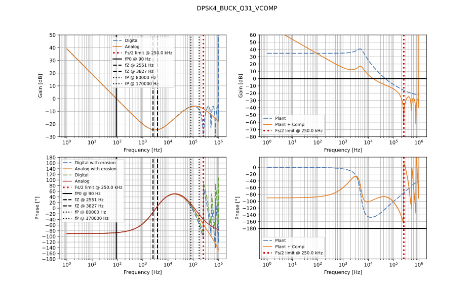

<div>

</div>

<style>
r { color: Red }
o { color: Orange }
g { color: Green }
</style>

<r>*This script can be used and called by a GUI. See low link for details:*</r>
[GUI User's Guide)](./FILTER_CONFIG_GUI_DOCUMENTATION.md)

# *Digital Compensator Tool User's Guide*


## *Summary*
This script converts analog (S-domain) compensator designs into discrete-time (Z-domain) IIR filters which can be used in dsPIC33 DSC Software.
The tool takes compensator/filter configuration parameters from a `JSON` file (by default `./_config/filter_config.json`) which defines filter characteristics as **Poles** and **Zeros** frequencies.
The tool generates and outputs (as per ***JSON*** file parameters)
1. Bode plot of compensator transfer function:
    - In Analog domain
    - In Digital domain
    - With and without phase erosion (impact of calculation time delay perceived by loop as loss of phase)
2. `Header file` (C Code) which declares coefficients of equivalent IIR filter (using Bi-linear transform) in:
    - Floating point `(float)` format
    - 32-bit fractional fixed point format Q31 as `(int32_t)` with dual-bit shift scaling (Bit shift scaler for A Terms, (Bit shift scaler for B Terms)
    - 16-bit fractional fixed point format Q15 as `(int16_t)` (Bit shift scaler for A Terms, (Bit shift scaler for B Terms)

The dsPIC33 compensator library can import this header `.h` file to assign compensator coefficients variables to these constants.
To design several compensator instances, user can copy and paste entire folder to define a new `JSON` config file and a separated compensator instance. 

## *Quick Start*
1. Install dependencies (use your project Python interpreter / virtualenv):
```bash
python -m pip install numpy scipy control matplotlib fxpmath
```
2. Edit `./_config/filter_config.json` to define the compensator (example below) or create your own file. By default script launches `./_config/filter_config.json`
3. Run the main script from the `Compensator` folder:
    - if no specific configuration file required (using `./_config/filter_config.json` by default), run following command in terminal session:
        ```bash
        python nPnZ_compensator.py
        ```
    - if using specific configuration file such as `./_config/other_config_file.json`, run following command in terminal session:
        ```bash
        python nPnZ_compensator.py ./_config/other_config_file.json
        ```
## *Config File Content*
Below is an example:
```json
{
  "name": "dpsk4_vcomp",
  "h_file_name": "DPSK4_BUCK_Float_Compensator.h",
  "bode_plot_output_file_name": "DPSK4_BUCK_Float_Compensator_Bode_Plot.pdf",
  "type": "3P3Z",
  "filter_parameters": {
    "BODE_PLOT_MIN_FREQ_10powerN": 0,
    "BODE_PLOT_MAX_FREQ_10powerN": 6,
    "BODE_PLOT_NB_POINTS": 1000,
    "SAMPLING_FREQUENCY_HZ": 500000,
    "coefficient_format": "float",
    "frequencies_Hz": {
      "Integrator_pole": [{"frequency": 45, "type": "Integrator"}],
      "Zeros": [{"frequency": 2551, "type": "Zero"}, {"frequency": 3827, "type": "Zero"}],
      "Poles": [{"frequency": 80000, "type": "Pole"}, {"frequency": 170000, "type": "Pole"}]
    }
  }
}
```
Where:
- `"name"` is compensator name that will be used by script in generated files content to label things.
- `"h_file_name"` is the name of output file used as C Code header that will be output in `/_output_docs/` sub-folder
- `"bode_plot_output_file_name"` is the name of output pdf file for compensator bode plot stored in `/_output_docs/` sub-folder
- `"type"` is telling 1P1Z, 2P2Z.... nPnZ type of filter. *Script does not use this paramater, this is information only.*
- `"coefficient_format"` is giving Text file (ASCII export from Mindi as an example) as data source to plot open loop response (plant + compensator). If this parameter is missing or empty, by default it only plots compensator.
- in `"filter_parameters"`, several settings are required.
    - `"BODE_PLOT_MIN_FREQ_10powerN"` defines the power of ***10<sup>BODE_PLOT_MIN_FREQ_10powerN</sup>*** (here in example ***10<sup>0</sup>=1Hz*** ) for start frequency of bode plots.
    - `"BODE_PLOT_MAX_FREQ_10powerN"` defines the power of ***10<sup>BODE_PLOT_MAX_FREQ_10powerN</sup>*** (here in example ***10<sup>6</sup>=1MHz*** ) for stop frequency of bode plots. Generally taking upper bound or sampling frequency.
    - `"BODE_PLOT_NB_POINTS"` defines number of points calculated for Bode plots along frequencies. *This is only used to render Bode plots and has no influence on coefficients calculated.*
    - `"SAMPLING_FREQUENCY_HZ"` defines the system sampling frequency so the rate compensation calculations are performed (same as switching frequency of the system if compensation calculations are run at each cycle).
    - `"coefficient_format"`defines the coefficients number format that will be used by dsPIC33 DSC and will decide format of constants declared in C code header file generated by the script. It can be:
        - `"Q15"` for 16-bit Fixed Point Fractional
        - `"Q31"` for 32-bit Fixed Point Fractional
        - `"float"` for Floating Point
    - `"Integrator_pole"` section is always required to have one and only one setting which defines ***Pole At Origine/Integrator*** by using an array of parameters. Regular ***Poles*** and ***Zeros*** will follow same format in other sections.
    As an example in default `JSON` file, `[{"frequency": 45, "type": "Integrator"}]` where `45' sets frequency at 45Hz for ***F~P0~ Pole at Origin/Integrator***.
    - `"Zeros"` section follows the same principle to define ***Zeros*** of compensator filter. As an example, they are defined as array of ***Zero***. Number of ***Zeros*** into the array will define the n in nP***n***Z filter order. For each ***Zero***, user can fine tune `"frequency"` as desired, as well as remove/add ***Zeros***. `"frequency"` is stated as ***Hz***.
    `"Zeros": [{"frequency": 2551, "type": "Zero"}, {"frequency": 3827, "type": "Zero"}]`
    - `"Poles"` section works exact same way as `"Zeros"` section but for ***Poles***.

## *Output File Content*
The script generates output files in `_output_docs/` subfolder.
  - A PDF Bode plot comparing analog (S) and digital (Z) responses: `_output_docs/<bode_plot_output_file_name>` as set in `JSON` configuration file. PDF displays phase curves with and without ***estimated*** phase erosion.
PDF file content example when there is no plant data:
<div>

</div>

   - A PDF Bode plot as per above which includes open loop response with plant data when plant text file is present and put in `JSON` config file:
<div>

</div>

The phase erosion highly depends on definition of parameters passed in `JSON` file: 
    ```json
    "ESTIMATED_DIGITAL_FILTER_TIME_DELAY_IN_S": 700e-9,
    "ESTIMATED_ADC_TRIGGER_POINT_DELAY": 1e-6,
    ```

- A C header file with coefficient macros (FLOAT, Q31, Q15): `_output_docs/<h_file_name>`. Example:
    ```c
    #ifndef DPSK4_BUCK_Q31_VCOMP_H
    #define DPSK4_BUCK_Q31_VCOMP_H

    /***************************************************************************************
    * DSP Coefficient header file generartion in Q15, Q31, Float formats 
    ****************************************************************************************
    * POLES AND ZEROS LOCATIONS:
    *   fP0 Pole at Origin Frequency: 90 Hz
    *   fZ1 Zero Frequency: 2551 Hz
    *   fZ2 Zero Frequency: 3827 Hz
    *   fP1 Pole Frequency: 80000 Hz
    *   fP2 Pole Frequency: 170000 Hz
    ****************************************************************************************/
    // DSP IIR Filter Coefficients for Compensator: dpsk4_buck_Q31_vcomp in Q31 format 
    #define DPSK4_BUCK_Q31_VCOMP_A1                          (int32_t) 0x5312EA39
    #define DPSK4_BUCK_Q31_VCOMP_A2                          (int32_t) 0xED9FC121
    #define DPSK4_BUCK_Q31_VCOMP_A3                          (int32_t) 0xFF4D54A6
    #define DPSK4_BUCK_Q31_VCOMP_A1                          (int32_t) 0x43848C45
    #define DPSK4_BUCK_Q31_VCOMP_A2                          (int32_t) 0xC1C88519
    #define DPSK4_BUCK_Q31_VCOMP_A3                          (int32_t) 0xBC951012
    #define DPSK4_BUCK_Q31_VCOMP_A4                          (int32_t) 0x3E51173D
    #define DPSK4_BUCK_Q31_VCOMP_A_TERMS_BIT_SHIFT_SCALING   (int32_t) -1  // Common Bit Shift Scaling for A Terms
    #define DPSK4_BUCK_Q31_VCOMP_B_TERMS_BIT_SHIFT_SCALING   (int32_t) 1  // Common Bit Shift Scaling for B Terms

    #endif   //DPSK4_BUCK_Q31_VCOMP_H
    ```
- Console output summarizing the filter, the A/B coefficient arrays, and the generated header content.

- How to use in C: include the generated header, declare arrays using the macros, and apply the bit-shift scaling at runtime per your DSP framework.
From `"DPSK4_BUCK_Q31_Compensator.h"` file generated` by the script as per shown below:
```c
    #ifndef DPSK4_BUCK_Q31_VCOMP_H
    #define DPSK4_BUCK_Q31_VCOMP_H

    /***************************************************************************************
    * DSP Coefficient header file generartion in Q15, Q31, Float formats 
    ****************************************************************************************
    * POLES AND ZEROS LOCATIONS:
    *   fP0 Pole at Origin Frequency: 90 Hz
    *   fZ1 Zero Frequency: 2551 Hz
    *   fZ2 Zero Frequency: 3827 Hz
    *   fP1 Pole Frequency: 80000 Hz
    *   fP2 Pole Frequency: 170000 Hz
    ****************************************************************************************/
    // DSP IIR Filter Coefficients for Compensator: dpsk4_buck_Q31_vcomp in Q31 format 
    #define DPSK4_BUCK_Q31_VCOMP_A1                          (int32_t) 0x5312EA39
    #define DPSK4_BUCK_Q31_VCOMP_A2                          (int32_t) 0xED9FC121
    #define DPSK4_BUCK_Q31_VCOMP_A3                          (int32_t) 0xFF4D54A6
    #define DPSK4_BUCK_Q31_VCOMP_A1                          (int32_t) 0x43848C45
    #define DPSK4_BUCK_Q31_VCOMP_A2                          (int32_t) 0xC1C88519
    #define DPSK4_BUCK_Q31_VCOMP_A3                          (int32_t) 0xBC951012
    #define DPSK4_BUCK_Q31_VCOMP_A4                          (int32_t) 0x3E51173D
    #define DPSK4_BUCK_Q31_VCOMP_A_TERMS_BIT_SHIFT_SCALING   (int32_t) -1  // Common Bit Shift Scaling for A Terms
    #define DPSK4_BUCK_Q31_VCOMP_B_TERMS_BIT_SHIFT_SCALING   (int32_t) 1  // Common Bit Shift Scaling for B Terms

    #endif   //DPSK4_BUCK_Q31_VCOMP_H
```

C-code usage Example:
s
```c
    #include "DPSK4_BUCK_Q31_Compensator.h"

    volatile int32_t vComp_ACoefficients [3] =						
    {						
        DPSK4_BUCK_Q31_VCOMP_A1, // Coefficient A1 will be multiplied with controller output u(n-1)						
        DPSK4_BUCK_Q31_VCOMP_A2, // Coefficient A2 will be multiplied with controller output u(n-2)						
        DPSK4_BUCK_Q31_VCOMP_A3  // Coefficient A3 will be multiplied with controller output u(n-3)						
    };						
                            
    volatile int32_t vComp_BCoefficients [4] =						
    {						
        DPSK4_BUCK_Q31_VCOMP_B0, // Coefficient B0 will be multiplied with error input e(n-0)						
        DPSK4_BUCK_Q31_VCOMP_B1, // Coefficient B1 will be multiplied with error input e(n-1)						
        DPSK4_BUCK_Q31_VCOMP_B2, // Coefficient B1 will be multiplied with error input e(n-2)						
        DPSK4_BUCK_Q31_VCOMP_B3, // Coefficient B1 will be multiplied with error input e(n-3)						
    };

    // For Q31/Q15, values are already hex constants; apply hardware-specific shifts using
    // A_TERMS_BIT_SHIFT_SCALING_Q31 and B_TERMS_BIT_SHIFT_SCALING_Q31 values present in the header.
    // Computation normalization factors						
    volatile int32_t vComp_pre_shift = 8;       // Bit-shift value used to perform input value normalization. 12-bit ADC input shifted to Q20						
    volatile int32_t vComp_post_shift_A = DPSK4_BUCK_Q31_VCOMP_A_TERMS_BIT_SHIFT_SCALING;   // Bit-shift value A used to perform control output value backward normalization						
    volatile int32_t vComp_post_shift_B = DPSK4_BUCK_Q31_VCOMP_B_TERMS_BIT_SHIFT_SCALING;    // Bit-shift value B used to perform control output value backward normalization						
    volatile int32_t vComp_post_scaler = 0;     // Q31 fractional factor used to perform control output value backward normalization
```

## *Contact / troubleshooting*
- Author: Anthony PELE (MICROCHIP TECHNOLOGY INC.)
- To raise issues or change/upgrade requests, please send an email to following address (answer is not guaranteed)
    <a href="mailto:anthony.pele@microchip.com">anthony.pele@microchip.com</a>

## *License*

This tool is provided for use within Microchip Technology Inc. projects. Refer to your organization's software licensing policy for usage terms.


<div>

</div>

